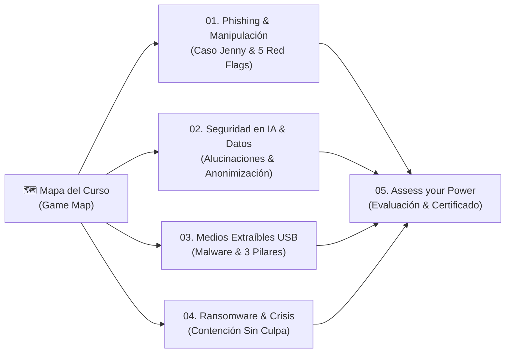

# CyberShield // Plataforma de Capacitación y Concientización (Awareness Training)

Plataforma web interactiva de entrenamiento y concientización en ciberseguridad corporativa. Diseñada a partir de las 4 presentaciones oficiales de referencia (`Phishing.pptx`, `AI Safety and data protection.pptx`, `USB.pptx`, y `Ransomware.pptx`), eliminando formatos aburridos o pasivos para ofrecer una experiencia de aprendizaje guiada por módulos interactivos, simuladores prácticos y evaluación situacional.

---

## 🗺️ Mapa del Curso y Módulos de Aprendizaje



### 1. Módulo 1: Phishing & Manipulación Social (`Phishing.pptx`)
- **Fundamentos:** El flujo de ataque clásico (*El Caso de Jenny*: atacante identifica datos → se disfraza de fuente confiable → convence a la víctima).
- **Simulador Práctico:** Visor de correo con **Escáner de Banderas Rojas** (inspección de remitentes alterados, urgencia artificial y adjuntos con doble extensión ejecutable `.pdf.exe`).
- **Resumen:** Las 5 Banderas Rojas para recordar en el día a día.

### 2. Módulo 2: Seguridad en IA & Protección de Datos (`AI Safety and data protection.pptx`)
- **Fundamentos:** Los 3 riesgos críticos de la IA (*Desinformación/Alucinaciones*, *Sesgos e Inconsistencias*, *Fuga de Datos Confidenciales*).
- **Práctica Interactiva:** Anonimización directa de prompts tocando entidades sensibles (clientes, personal, finanzas, contraseñas) y selección entre *IA Pública* y *Bóveda Corporativa Protegida* hasta reducir el riesgo a 0%.
- **Resumen:** Las 4 reglas de oro del uso responsable de IA en el trabajo.

### 3. Módulo 3: Medios Extraíbles (USB) & Amenazas Físicas (`USB.pptx`)
- **Fundamentos:** Qué es el Malware (virus, troyanos, spyware) y vectores físicos (USB abandonados / *Baiting*, cables alterados / *Juice Jacking*, pantallas desatendidas).
- **Práctica Interactiva:** Escenario de oficina/cafetería con 4 dilemas cotidianos conectados con los **3 Pilares de Seguridad** (*Privacidad*, *Exactitud*, *Continuidad*).
- **Resumen:** Hábitos físicos para colaboradores en movilidad o teletrabajo.

### 4. Módulo 4: Ransomware & Respuesta ante Incidentes (`Ransomware.pptx`)
- **Fundamentos:** Qué es el secuestro digital, cómo opera el cifrado malicioso y consecuencias operativas en la empresa.
- **Simulador Práctico:** Protocolo de contención de primeros auxilios digitales en 4 pasos bajo **Cultura de Cero Culpa (No-Blame)**:
  1. *Desconectar red y Wi-Fi* (cortar propagación lateral)
  2. *Apagar el equipo* (congelar memoria y disco)
  3. *Notificar de inmediato a TI* (reporte temprano sin represalias)
  4. *Restaurar desde respaldos aislados* (recuperación limpia)
- **Resumen:** La importancia de avisar a tiempo sin miedo a sanciones.

### 5. Assess your Power: Evaluación & Certificado Oficial
- **Test Situacional:** 4 preguntas prácticas para medir el criterio en los 4 temas.
- **Puntos e Insignias:** Acumulación de *Awareness Points* y desbloqueo de insignias (*Phishing Hunter*, *AI Guardian*, *USB Defender*, *Incident First*).
- **Certificado Acreditado:** Generación de Diploma de Finalización personalizado y listo para imprimir o guardar en PDF.

---

## 🎨 Sistema Visual y Estándares UI/UX (Skill `ui-ux-pro-max`)

- **Paleta Cromática:** Basada en la identidad de las presentaciones: verde azulado/esmeralda profundo (`#00251e` a `#004d40`), tarjetas de lectura de alto contraste, acentos menta (`#10b981`), cian (`#00e5ff`), ámbar (`#f59e0b`) y coral (`#f43f5e`).
- **Retroalimentación Sonora (Web Audio API):** Sonidos procedurales de acierto, descubrimiento y redacción generados por código sin archivos MP3 externos.
- **Accesibilidad:** WCAG 2.2 AAA con soporte para teclado y área táctil mínima de 44 px.

---

## 💻 Ejecución y Despliegue

```bash
# Iniciar servidor local
npm start
# O con Python:
python -m http.server 3000
```
Navega en tu explorador a: `http://localhost:3000`

Para generar la versión de archivo único compilada (apta para Google AI Studio o LMS):
```bash
npm run build
```
Genera `dist/standalone.html`.
