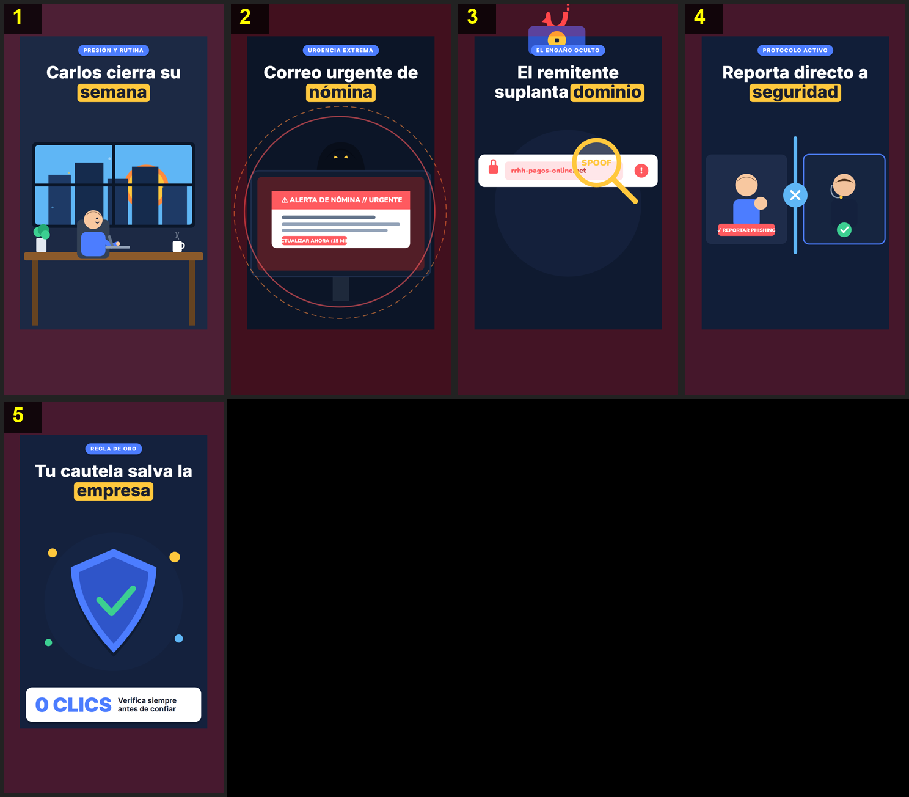

# Flat 2D: Guía y Estándares de Animación Dinámica y Rigurosa



Estética Flat 2D de alta fidelidad: vectores limpios sin contornos toscos de cómic, sombras planas en tonalidades más profundas del mismo matiz, fondos de ciberseguridad corporativos (#0d1117, #14213d, #0b1528) y títulos de alto contraste con píldora amarilla (`#ffc83d`) sobre la palabra clave. Todas las animaciones operan sobre GSAP a 60 fps en canvas 1080x1920 con zona segura estricta.

## 1. Principios de Animación Expresiva (Motion Graphics Senior)

1. **Squash & Stretch (Compresión y Estiramiento):**
   - Todo impacto o botón presionado se deforma brevemente antes de recuperar su masa:
     ```ts
     tl.to(btn, { scaleX: 1.15, scaleY: 0.85, duration: 0.1, yoyo: true, repeat: 1, ease: 'power2.inOut' });
     ```
2. **Anticipación y Rebasamiento (Overshoot):**
   - Los elementos que ingresan a escena sobrepasan su posición final y se asientan suavemente:
     ```ts
     tl.fromTo(badge, { scale: 0, opacity: 0 }, { scale: 1, opacity: 1, duration: 0.5, ease: 'back.out(1.8)' });
     ```
3. **Pacing y Curvas de Aceleración:**
   - Evita `ease: 'none'` salvo para rotaciones continuas o scanlines. Usa `power3.out` para entradas contundentes, `expo.out` para destellos y `elastic.out(1, 0.4)` para bloqueos defensivos.
4. **Capas de Profundidad Ambiental:**
   - Cada escenario se compone de mínimo 3 planos:
     - **Fondo (Backdrop):** Ventanal, horizonte de ciudad, pared de servidores o racks con luces parpadeantes.
     - **Plano Medio (Midground):** Escritorio, monitor, cables o consola de mando.
     - **Primer Plano (Subject / Focus):** Personaje (Carlos / Sofía / Atacante), elemento forense o dispositivo interactivo.
     - **Capa Atmosférica:** Partículas flotantes de luz, rayos de escaneo sutiles y micro-vibraciones.

## 2. Zona Segura 9:16 (TikTok, Shorts, Reels)

El canvas es de **1080 x 1920 px**.
- Zona segura central: **x de 80 a 1000 px**, **y de 160 a 1600 px** (`SAFE` en `library.ts`).
- Los 320 px inferiores y los 160 px superiores quedan reservados para la interfaz de las plataformas de video.
- Solo los fondos estructurales cubren el marco completo; todo personaje, dispositivo, badge o texto debe vivir rigurosamente dentro de la zona segura.

## 3. Síntesis de Voz en Local con Voicebox

- Servidor local en `http://127.0.0.1:17493` emulando la API oficial de Voicebox con voz `es-MX Hilda` (Español Latino).
- Comando de síntesis:
  ```bash
  node core/voice.ts videos/<topic>
  ```
- Genera el archivo maestro `videos/<topic>/audio.wav` (~23–26s, 48 kHz mono), que lidera la línea de tiempo del reproductor.

## 4. Auto-Ducking y Mezcla de Sonido

- **Canal 0 (Voz):** 100% de ganancia. Es la guía maestra de la cápsula.
- **Canal 1 (Música de fondo):** Generada por oscilador sintetizado con atenuación dinámica al 15-20% durante las locuciones.
- **Canal 2 (Efectos SFX táctiles):** Clic de teclado, alerta de intrusión, zumbido de escaneo y activación de escudo a 35-45% sin enmascarar la voz.

## 5. Regla de Oro de Contenido

- Prohibido cualquier meta-comentario técnico o mención a lenguajes, frameworks o DOM en los textos de pantalla.
- Toda palabra comunica resiliencia, verificación humana y hábitos seguros de respuesta ante ciberamenazas.
