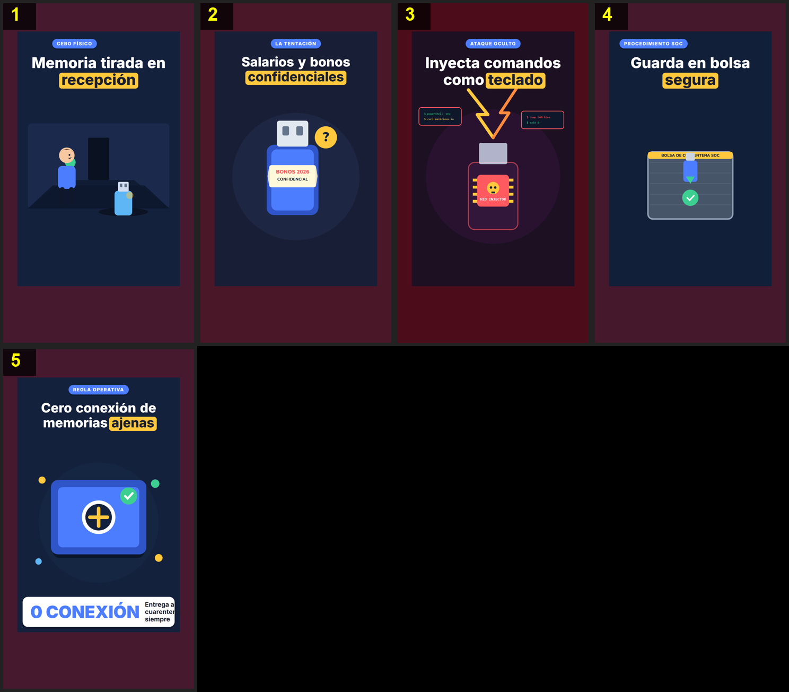

# Storyboard: badusb-alert (flat2d)

| panel | scene | t (s) | type | title | stat |
|---|---|---|---|---|---|
| 1 | find | 3.1 | process | Memoria tirada en recepción |  |
| 2 | temptation | 8.1 | question | Salarios y bonos confidenciales |  |
| 3 | danger | 13.1 | process | Inyecta comandos como teclado |  |
| 4 | contain | 18.1 | process | Guarda en bolsa segura |  |
| 5 | quarantine | 23.1 | stat | Cero conexión de memorias ajenas | 0 CONEXIÓN |
