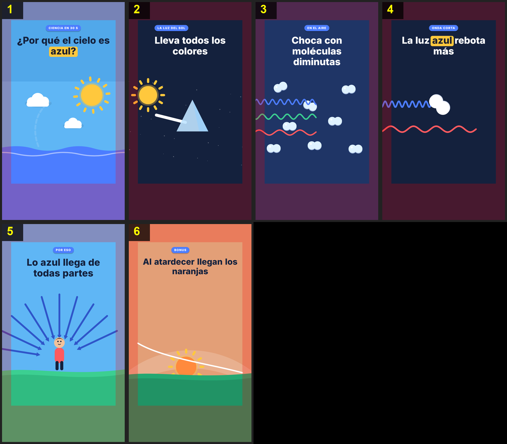

# Storyboard: blue-sky (flat2d)

| panel | scene | t (s) | type | title | stat |
|---|---|---|---|---|---|
| 1 | hook | 2.44 | question | ¿Por qué el cielo es azul? |  |
| 2 | white | 8.01 | object | Lleva todos los colores |  |
| 3 | collision | 12.52 | process | Choca con moléculas diminutas |  |
| 4 | blue | 18.5 | stat | La luz azul rebota más | ≈6× |
| 5 | everywhere | 24.08 | map | Lo azul llega de todas partes |  |
| 6 | sunset | 30.91 | closing | Al atardecer llegan los naranjas |  |
